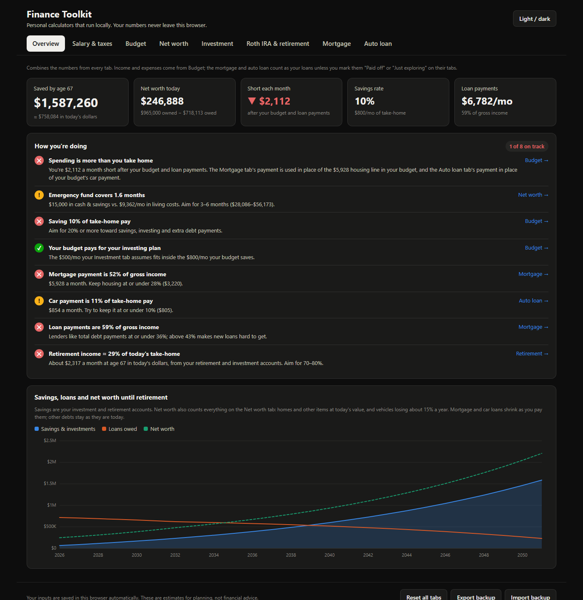
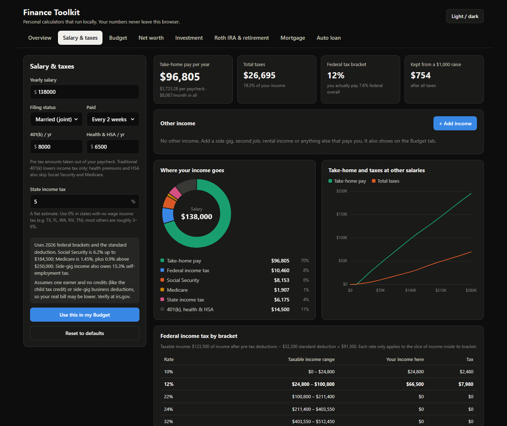
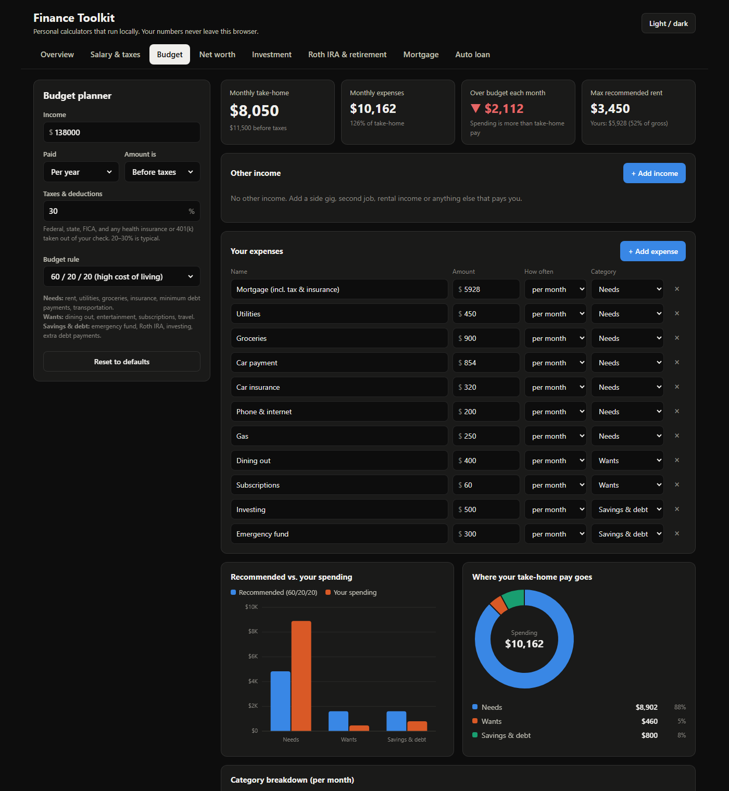
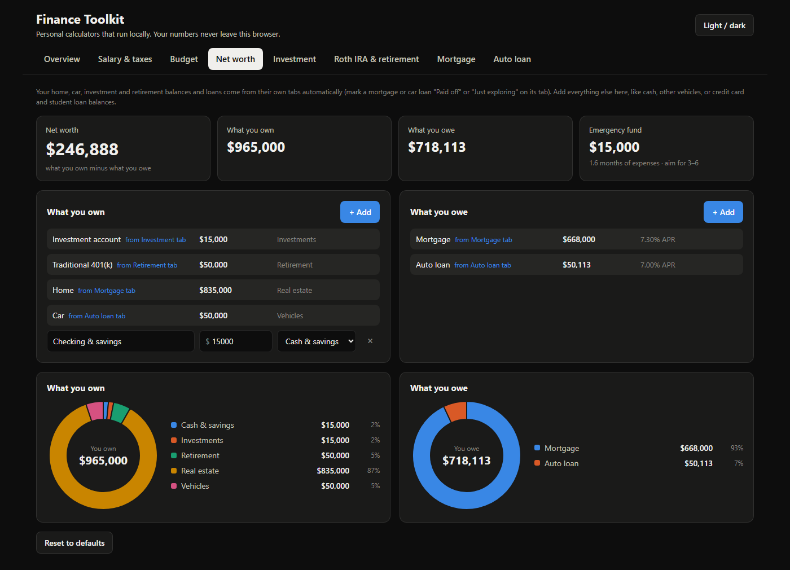
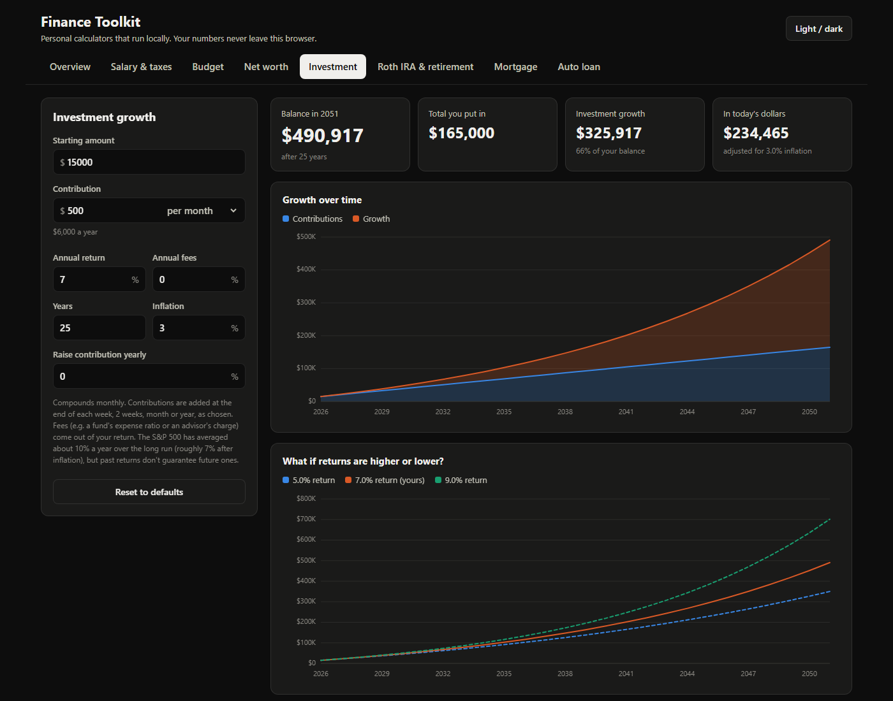
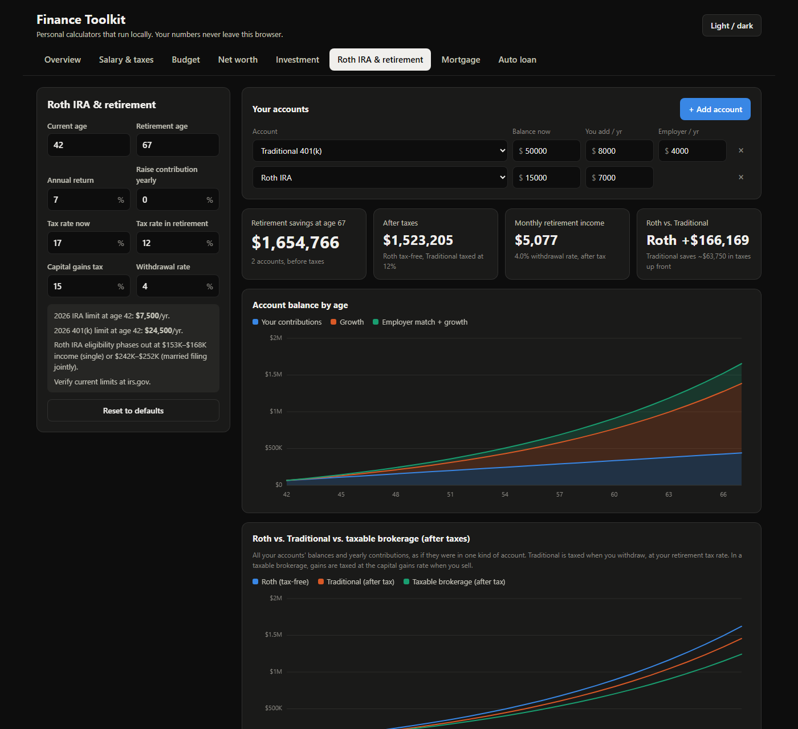
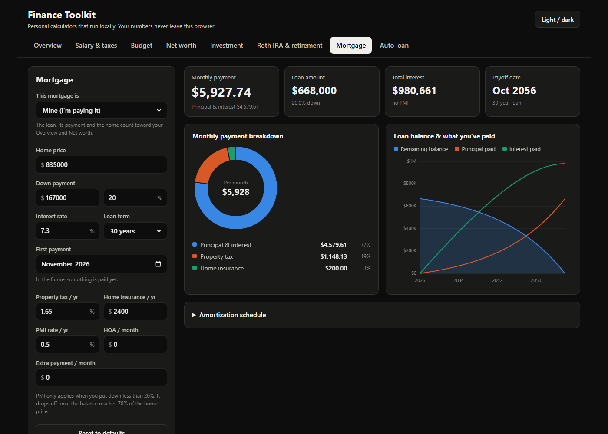
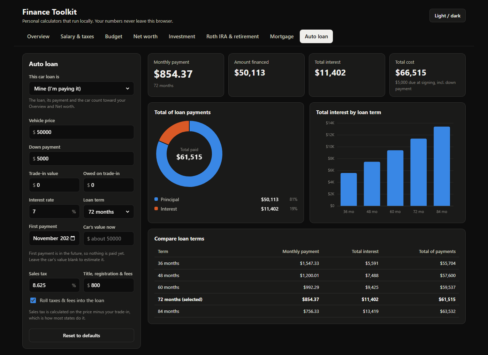
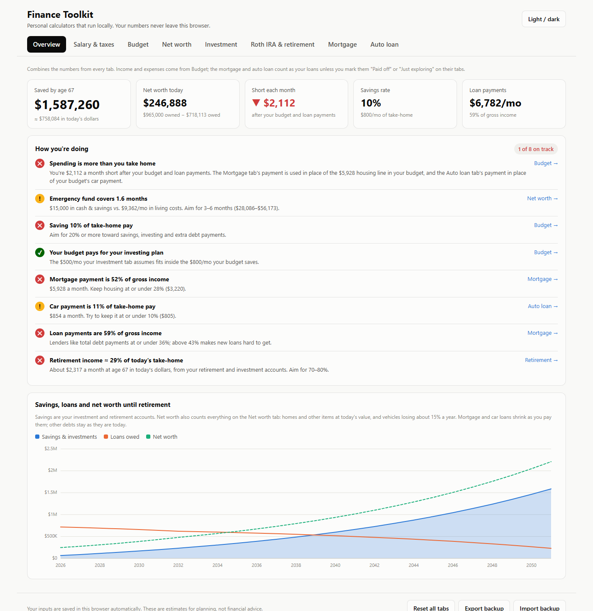

# Finance Toolkit

**Private personal-finance calculators that run entirely on your own computer.** No accounts, no sign-ups, no bank linking, no ads, no tracking. Your numbers never leave your browser.



## Why

Most budgeting and planning sites want you to create an account, link your bank, and hand over your financial details, and many make money from ads or from your data. Finance Toolkit takes the opposite approach:

- **Runs locally.** It's a plain web page. Open `index.html` and it works, even offline.
- **Nothing to install.** No server, no build step, no dependencies, no internet connection needed.
- **Your data stays on your machine.** Inputs are saved in your browser's local storage on this computer only. Nothing is sent anywhere.
- **You own your data.** Export everything to a JSON file to back it up or move it to another computer, and import it back any time.
- **Easy to read and change.** Plain HTML, CSS and JavaScript with no frameworks.

## Getting started

1. Download this repository: click **Code → Download ZIP** and unzip it, or clone it with `git clone <this repository's URL>`.
2. Open `index.html` in any modern browser (Chrome, Edge, Firefox or Safari).

That's it. Your numbers save automatically as you type.

## What's inside

| Tab | What it does |
|---|---|
| **Overview** | Combines every tab into one picture: savings by retirement, net worth, monthly cash flow, and a checklist of how you're doing (emergency fund, savings rate, housing and debt ratios, high-interest debt, retirement income). |
| **Salary & taxes** | Take-home pay from your salary using 2026 federal brackets, Social Security, Medicare and state tax. Handles 401(k) and HSA deductions and extra income (second job, side gig with self-employment tax, rental). |
| **Budget** | Plan income against expenses with a 50/30/20-style rule. Extra income streams are shared with the Salary tab. |
| **Net worth** | What you own minus what you owe. Pulls in your home, car, loans and account balances from the other tabs; add cash, other vehicles and debts yourself. |
| **Investment** | Growth of regular contributions (weekly, every 2 weeks, monthly or yearly), with fees, inflation and higher or lower return scenarios. |
| **Roth IRA & retirement** | Add every retirement account you have (for example a Roth IRA and a 401(k)) and see them grow together. Compares Roth vs. Traditional vs. a taxable account, with 2026 contribution limits and employer match. |
| **Mortgage** | Monthly payment including taxes, insurance and PMI, extra payments, the amortization schedule, and today's balance from your first payment date. |
| **Auto loan** | Payment, total interest, comparison of loan terms, today's balance, and your car's estimated current value. |

Mortgages and car loans can be marked **Mine**, **Paid off** or **Just exploring**, so you can try out numbers without them counting toward your Overview.

## Screenshots

| | |
|---|---|
|  **Salary & taxes** |  **Budget** |
|  **Net worth** |  **Investment** |
|  **Roth IRA & retirement** |  **Mortgage** |
|  **Auto loan** |  **Light theme** |

## Starting numbers

The calculators start empty: your income, balances, home and car prices, budget expenses and net worth items are all blank, ready for your own numbers. Only general assumptions are filled in (interest and return rates, tax rates, loan terms, inflation, your age and retirement age), and you can change any of them.

**Reset all tabs** in the footer clears everything back to this empty starting point.

## Your data

- Everything is saved in your browser's `localStorage` for this page, on this computer only. Clearing your browser's site data erases it.
- **Export backup** downloads a `.json` file of all your inputs; **Import backup** restores it.
- **Reset to defaults** on each tab, or **Reset all tabs** in the footer, clears your saved numbers.

## Keeping it up to date

Tax and contribution limits change every year. They live in two places:

- `js/salary.js`: the `TAX` object (federal brackets, standard deduction, Social Security wage base)
- `js/retirement.js`: the `LIMITS` object (IRA and 401(k) limits, Roth IRA income phase-outs)

## Project structure

```
index.html          the whole app: one page with a tab for each calculator
css/styles.css      layout, light and dark themes
js/util.js          shared helpers: formatting, saving inputs, tiles, tables
js/charts.js        small built-in SVG charts (line, bar, donut)
js/income.js        extra income streams shared by Salary and Budget
js/*.js             one file per calculator, plus overview.js and app.js (tabs, theme, backups)
docs/screenshots/   images used in this README
```

## Disclaimer

This toolkit is for educational and planning purposes only. It does not provide financial, tax, or legal advice. Results are estimates and may be incomplete, inaccurate, or based on outdated assumptions. Verify inputs and current rules, and consult a qualified professional before making financial decisions.

## License

[MIT](LICENSE). You're free to use, change and share this code, as long as you keep the copyright notice.
